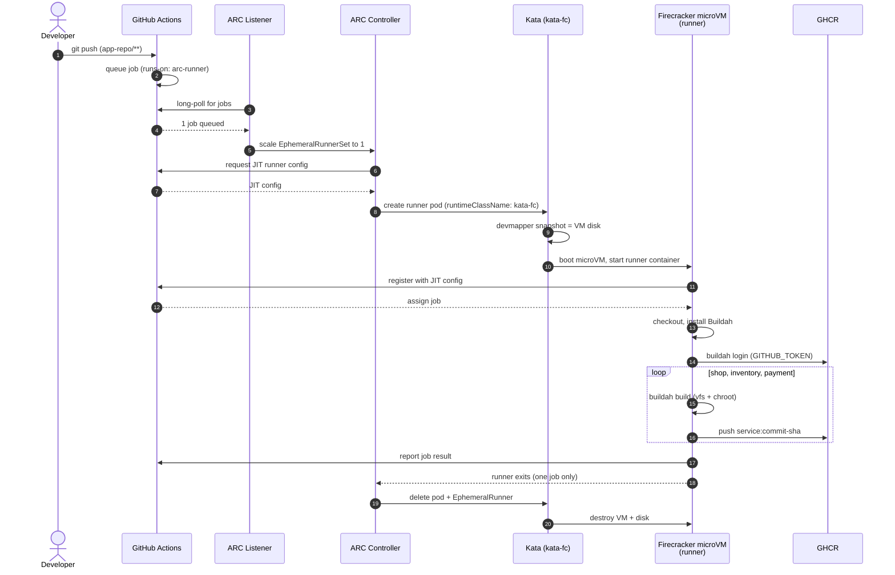

# firecracker-arc

Self-hosted GitHub Actions where each job runs in its own Firecracker microVM, builds the app images, and pushes them to GHCR.

## Stack

- **k3s** on WSL2 (`/dev/kvm`)
- **Kata Containers + Firecracker** → RuntimeClass `kata-fc`
- **ARC** (Actions Runner Controller) → one ephemeral runner pod per job
- **Buildah** → builds without a Docker daemon
- **GHCR** → images tagged with the short commit SHA (7 chars), pushed with `GITHUB_TOKEN` (`packages: write`)

## Setup

1. Kata + Firecracker: `infra-repo/kata-fc-devmapper/README.md`
2. Runners: `infra-repo/github_arc/README.md`
3. Push to `main` or run the `build-and-push` workflow.

## Layout

| Path | What |
|---|---|
| `.github/workflows/ci.yaml` | Build + push to GHCR |
| `app-repo/` | `shop`, `inventory`, `payment` services |
| `infra-repo/kata-fc-devmapper/` | Kata + Firecracker on k3s |
| `infra-repo/github_arc/` | ARC runner config |
| `infra-repo/micro-service/` | Kustomize manifests |
| `infra-repo/argocd/` | Argo CD |
| `local/` | Standalone Firecracker VM |
