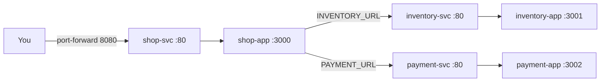

# Minimarket micro-services

Kustomize manifests for the three Minimarket services, deployed to the `minimarket` namespace.



## Services

| Service | Deployment | Container port | Image |
|---|---|---|---|
| `shop-svc` | `shop-deploy` | 3000 | `ghcr.io/rocketonthemoon/shop-service:<sha>` |
| `inventory-svc` | `inventory-deploy` | 3001 | `ghcr.io/rocketonthemoon/inventory-service:<sha>` |
| `payment-svc` | `payment-deploy` | 3002 | `ghcr.io/rocketonthemoon/payment-service:<sha>` |

All services listen on port **80** and forward to the container port. Each pod requests `50m` CPU / `64Mi` and is limited to `500m` / `256Mi`.

## Layout

```
micro-service/
├── kustomization.yaml     # namespace: minimarket + all apps
├── namespace.yaml
└── apps/
    ├── shop/              # deployment.yaml, service.yaml, kustomization.yaml
    ├── inventory/
    └── payment/
```

## Deploy

```bash
kubectl apply -k .
kubectl get pods -n minimarket
```

## Open the shop

```bash
kubectl port-forward -n minimarket service/shop-svc 8080:80
```

Then browse to <http://localhost:8080>.

## Update images

Images are tagged with the 7-char commit SHA by CI. Change the tag in each `apps/*/deployment.yaml`, then re-apply:

```bash
kubectl apply -k .
```

## Remove

```bash
kubectl delete -k .
```
